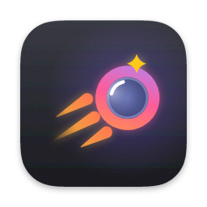
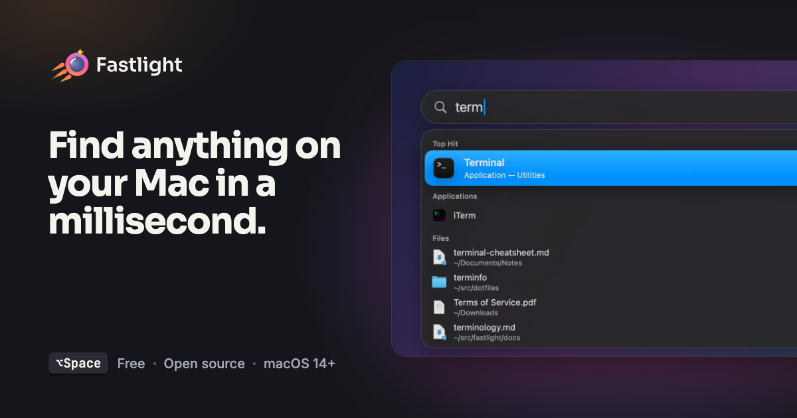
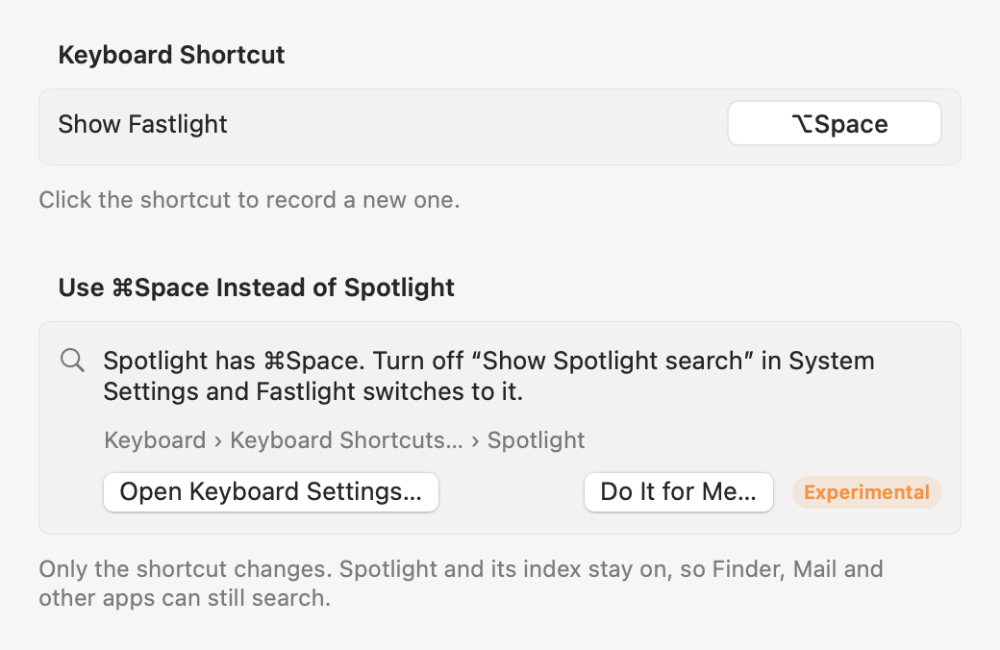

<div align="center">



# Fastlight

*A Spotlight-style launcher for macOS that finds any app or file in about a millisecond.*

[](https://github.com/elboletaire/fastlight/actions/workflows/ci.yml)


[](https://github.com/noahdunnagan/fsearch)
[](LICENSE)

[Features](#features) • [Install](#install) • [Usage](#usage) • [Replace Spotlight](#replace-spotlight) • [Extensions](#extensions) • [Build from source](#build-from-source) • [How it works](#how-it-works) • [Website](https://elboletaire.github.io/fastlight/)



</div>

Press **⌥Space** anywhere, type a few letters, hit **↵**. Fastlight searches your applications and your whole disk as you type, with fuzzy matching that forgives typos, and stays out of the way in the menu bar. File search is done by [fsearch](https://github.com/noahdunnagan/fsearch), which is bundled inside the app: there is nothing else to install.

## Features

- **Apps and files, kept apart.** A Top Hit, then Applications with their real icons, then Files, each in its own section.
- **Fast, all the time.** Name search over millions of files in about a millisecond, so results update on every keystroke with no debounce.
- **Forgiving matching.** `vsc` finds Visual Studio Code, `sys set` finds System Settings, `mian.rs` still finds `main.rs`. Apps you open often move up.
- **Search inside files.** `grep:`, `regex:` and `sym:` search file contents through fsearch's index and show the matching line. ↵ opens it at that line in VS Code, Cursor, VSCodium, Zed, BBEdit or TextMate, when one of them is the file's default app.
- **Power-user filters.** `ext:`, `in:`, `size:`, `mtime:`, `kind:` and more, straight from the search field.
- **Emoji picker.** Type `:` and a name, keyword or Slack shortcode (`:joy`, `:tada:`) and ↵ pastes it where you were typing.
- **Calculator.** Type `1920*1080`, `2^10` or `15% of 80` and the answer is the Top Hit; ↵ copies it.
- **Conversions.** Units (`10 km in mi`, `72f in c`, `5 gb in mb`), world clocks (`time in tokyo`, `3pm london in nyc`) and date math (`days until dec 25`, `today + 90 days`), offline; ↵ copies the answer.
- **System Settings.** Type `bluetooth`, `displays` or `full disk access` and ↵ opens that pane of System Settings.
- **Shortcuts.** Run your shortcuts by name; `sc translate hello` passes "hello" as input.
- **System actions.** Lock Screen, Sleep, Toggle Dark Mode, Eject All Disks, and Empty Trash, Log Out, Restart and Shut Down, which ask for a second ↵ first.
- **Contacts.** Type a name, company, email or number and the person shows up; `contact ` lists them with their addresses and numbers, one ↵ away from an email, a call, a message or FaceTime.
- **Calendar and Reminders.** `cal ` is today's agenda and the next two weeks, `remind ` what's due, overdue first; type a few letters of an event or reminder and it shows up in normal search too. Read-only, and only once you allow it.
- **Dictionary.** Type `define serendipity` for definitions from the dictionaries built into macOS, offline. Only after `define `/`dict `, so normal search stays apps and files. ↵ opens it in Dictionary.app.
- **Web.** Type `github.com` or `localhost:3000` and opening it is the Top Hit. Type `web ` and anything to search Google (or DuckDuckGo, Wikipedia…; the default is [configurable](docs/extensions/README.md)) in your browser.
- **Extensions in any language.** A folder with a manifest and a script or binary that speaks JSON lines. See [Extensions](#extensions).
- **Feels native.** A floating panel that looks and behaves like Spotlight, with Liquid Glass on macOS 26 and later, Quick Look, and Reveal in Finder.
- **Private.** Everything runs locally. No network access, no accounts, no telemetry. Contacts, Calendar and Reminders are read from this Mac's own stores, only after you allow it, and never written to. (Extensions you install can do whatever their code does.)

## Install

1. Download `Fastlight-<version>.dmg` from the [latest release](https://github.com/elboletaire/fastlight/releases/latest), open it and drag **Fastlight** onto **Applications**.
2. Give `/Applications/Fastlight.app` **Full Disk Access** in System Settings › Privacy & Security, so it can see Desktop, Documents and other protected folders. Doing it before the first launch saves a restart of the search daemon, but granting it later works too: Fastlight notices and restarts the daemon by itself. Until then the panel shows a shortcut to that setting.
3. Open Fastlight. It lives in the menu bar; press **⌥Space** to search.

> [!NOTE]
> Builds that aren't notarized are blocked the first time you open them. Go to System Settings › Privacy & Security and click **Open Anyway**.

> [!NOTE]
> Releases are signed ad hoc until there is a Developer ID, so each update has a new signature and macOS drops the Full Disk Access grant. After updating, remove Fastlight from the Full Disk Access list and add it again.

> [!TIP]
> Want another shortcut? Pick one in **Settings…** from the menu bar icon. For **⌘Space**, see [Replace Spotlight](#replace-spotlight).

The first time it runs, fsearch indexes the whole disk (around 20 seconds) and Fastlight shows its progress. After that the index stays current on its own and survives restarts. Apps are searched from the start, even while files are still being indexed.

### Troubleshooting

If files from Desktop or Documents still don't show up with Full Disk Access granted, reset the grant, stop the daemon, and open Fastlight again:

```sh
tccutil reset SystemPolicyAllFiles com.elboletaire.fastlight
pkill -f 'fsearch serve'
```

Then add Fastlight back to the Full Disk Access list. Its log is in `~/Library/Application Support/FSearch/daemon.log`.

## Usage

| Key | Does |
|---|---|
| ⌥Space (or your own, see Settings) | Show / hide |
| ↑ ↓ | Move through results |
| Tab, ⇧Tab (or ⌘↓, ⌘↑) | Next / previous section |
| ↵ | Open (an extension result: its main action, like Paste) |
| ⌘↵ | Show in Finder (an extension result: its second action, like Copy) |
| ⌘Y | Quick Look |
| ⌥⌘C | Copy path |
| ⌫ on an empty field | Leave an extension's keyword mode |
| ⎋ | Clear, then close |

The search field takes fsearch's query language. Words are fuzzy, and words of five letters or more survive one typo; operators narrow them down, and filters do the rest:

```text
invoice ext:pdf mtime:<30d       PDFs named like "invoice", changed this month
readme in:~/src                  only inside ~/src
type:image size:>5mb             big images
grep:TODO ext:swift              lines containing TODO in Swift files
sym:applyFilter                  where a symbol is defined
```

| Operator | Does |
|---|---|
| `'exact` | No fuzziness |
| `^prefix` | Name starts with |
| `suffix$` | Name ends with |
| `!word` | Leave out paths with it in the name or a folder: `!node_modules`. Works with `'`, `^` and `$` too: `!.bak$` |
| `"two words"` | Quotes keep spaces in one word or value: `in:"~/My Notes"` |
| `folder/name` | Words can match folders on the path too, as long as one is in the name; `/` splits words. `src readme` and `src/readme` both find `~/src/app/README.md` |

| Filter | Does |
|---|---|
| `ext:` | Extension; commas for several: `ext:jpg,png` |
| `type:` | `image`, `video`, `audio`, `doc`, `code`, `archive`, `font` or `app`; commas for several |
| `kind:` | `file` (`f`), `dir` (`folder`, `d`) or `link` (`symlink`, `l`) |
| `in:` | Only under a folder, absolute or `~`: `in:~/src` |
| `size:` | `size:>5mb`, `size:1m..10m` |
| `mtime:` | Modified within (`mtime:<7d`) or longer ago than (`mtime:>1y`). Also `modified:` |
| `re:` | Regex over the name, ignoring case: `re:^IMG_\d+` |
| `path:` | Regex over the full path, ignoring case: `path:/tests?/` |
| `grep:` | Text inside files; ignores case unless it has capitals. Also `content:` |
| `regex:` | Regex inside files; ignores case unless it has capitals: `regex:fn\s+main` |
| `sym:` | Where a symbol is defined, case and all. Also `symbol:` |

`size:` and `mtime:` take `>`, `>=`, `<`, `<=` or a range `a..b`, and `size:` an exact value too. Sizes are in `b`, `k`/`kb`, `m`/`mb`, `g`/`gb` or `t`/`tb` (1 kb is 1000 bytes), and a bare number means bytes; times are in `s`, `m`/`min`, `h`, `d`, `w`, `mo` or `y`, and a bare number means days. Matching ignores case, except `sym:` and `grep:` or `regex:` patterns with capitals. The same reference is in **About Fastlight**.

Plain queries leave out noise like app bundles, dot-folders, `node_modules` and `~/Library`. Any filter turns that off, so `in:~/Library` searches there as usual.

## Replace Spotlight

Fastlight starts on ⌥Space because ⌘Space belongs to Spotlight. To move it, open **Settings…** from the menu bar icon: **Use ⌘Space Instead of Spotlight** walks you through it. There are two ways, because macOS has no public API for another app to take over Spotlight's shortcut.

- **Recommended:** click **Open Keyboard Settings…**, then **Keyboard Shortcuts… › Spotlight** and turn off **Show Spotlight search**. Fastlight notices while its Settings window is open and switches to ⌘Space by itself.
- **Do It for Me (experimental):** after asking, Fastlight turns off that one shortcut in `com.apple.symbolichotkeys` and applies it right away. It keeps a copy of the previous setting, so **Restore Spotlight's Shortcut** puts it back exactly and returns Fastlight to ⌥Space. If a future macOS doesn't pick the change up, Settings says so and it takes effect after you log out and back in.

Either way only the shortcut changes. Spotlight stays on, and so does its index, which Finder, Mail and other apps search with; ⌥⌘Space (Finder search) is left alone. If Fastlight is set to ⌘Space while Spotlight still has it, ⌘Space opens Spotlight, and Fastlight's Settings says so. To undo a manual change, pick another shortcut in Fastlight and turn **Show Spotlight search** back on.



## Extensions

Extensions add results, either when you type their keyword (`:` for emoji, `=` for the calculator) or, if they opt in, in their own section of the normal results. An extension is a folder in `~/Library/Application Support/Fastlight/Extensions/` with an `extension.json` and any executable that reads requests on stdin and answers on stdout, one JSON object per line: a 30-line shell script is enough.

```sh
cp -R examples/extensions/bc ~/Library/Application\ Support/Fastlight/Extensions/
```

Then type `bc 2*21`. Fastlight asks before running a new or changed extension for the first time, since it runs with Fastlight's permissions. The menu bar icon › Extensions turns them on and off and opens their folder and logs.

The built-in extensions (emoji, calculator, conversions, dictionary, web, System Settings, Shortcuts, System, Contacts, Calendar and Reminders) are bundled and built the same way. Write your own with [the extension guide](docs/extensions/README.md); the design is in [docs/extensions/design.md](docs/extensions/design.md).

## Build from source

You need the Swift 6 toolchain (the Command Line Tools are enough, no Xcode) and Rust 1.85+ to compile fsearch:

```sh
brew install rustup && "$(brew --prefix rustup)/bin/rustup" default stable
git clone --recursive git@github.com:elboletaire/fastlight.git && cd fastlight
make            # build/Fastlight.app, with fsearch embedded
```

| Command | Does |
|---|---|
| `make run` | Build and open the app |
| `make install` | Build, quit the running copy and replace `/Applications/Fastlight.app` |
| `make dmg` | Build `build/Fastlight-<version>.dmg` |
| `make test` | Run the test suite |
| `make clean` | Remove build output |

`make dmg` lays out the DMG window (background, icon positions) with [dmgbuild](https://github.com/dmgbuild/dmgbuild), which it runs through [uv](https://docs.astral.sh/uv/) (`brew install uv`) or Python 3.10+. Without either it builds a plain DMG and warns.

`UNIVERSAL=1 make dmg` builds for both Apple Silicon and Intel, and `CODESIGN_IDENTITY="Developer ID Application: …"` signs with a real identity and the hardened runtime. The [release workflow](.github/workflows/release.yml) does both on `v*` tags, and notarizes when the secrets listed at its top are set.

Releasing is merging a version bump: when `CFBundleShortVersionString` in `Resources/Info.plist` changes on `main` to a version with no tag yet, [`tag-release.yml`](.github/workflows/tag-release.yml) tags it and runs the release workflow. Tags aren't pushed by hand.

The bundled fsearch keeps itself current: every Monday, [`fsearch.yml`](.github/workflows/fsearch.yml) checks fsearch's `main`. If it has moved on, it opens a PR (branch `deps/fsearch`) that updates the submodule, bumps the patch version and lists the upstream changes. CI runs on it, and merging it releases the new version. `scripts/bump-fsearch.sh` does the same locally. The workflow can also be run from the Actions tab at any time.

> [!IMPORTANT]
> Local builds are signed ad hoc, and macOS ties Full Disk Access to the signature. Grant it again after each rebuild, or sign with a real identity.

`scripts/snapshot.sh` renders the panel with sample data to `build/snapshots/`, in light and dark, which is handy when working on the design.

## How it works

Fastlight is a menu-bar app in Swift. It registers a global hotkey and shows a floating panel. Apps come from its own index of `/Applications`, `/System/Applications`, `~/Applications` and a few system folders, ranked by name match and by how often you open them. Files come from fsearch: Fastlight starts the bundled daemon at `Fastlight.app/Contents/Helpers/fsearch` and talks to it as JSON lines over `~/Library/Application Support/FSearch/fsearch.sock`.

| Path | What's there |
|---|---|
| `Sources/FastlightCore` | Search providers, fsearch client, app index and ranking, file result filter, extension host. No AppKit, covered by unit tests. |
| `Sources/Fastlight` | Menu-bar app, hotkey, panel and results UI. |
| `Sources/FastlightEmoji`, `Sources/fastlight-emoji` | The bundled emoji picker extension. Its data is in `Extensions/emoji`, regenerated by `scripts/generate-emoji.swift`. |
| `Sources/FastlightCalc`, `Sources/fastlight-calc` | The bundled calculator extension: its own expression parser, no `bc`. |
| `Sources/FastlightConvert`, `Sources/fastlight-convert` | The bundled conversions extension: units, time zones and dates. |
| `Sources/FastlightSystem`, `Sources/fastlight-system` | The bundled System Settings, Shortcuts and System extensions: one helper, three manifests in `Extensions/settings`, `shortcuts` and `system`. |
| `Sources/FastlightContacts`, `Sources/fastlight-contacts` | The bundled Contacts extension: search and actions, and the Contacts framework behind a protocol. |
| `Sources/FastlightCalendar`, `Sources/fastlight-calendar` | The bundled Calendar and Reminders extensions, one EventKit helper for both. `Sources/FastlightPIM` is what they share with Contacts: access states, permission items, the background loader. |
| `Sources/FastlightDictionary`, `Sources/fastlight-dict` | The bundled dictionary extension, on DictionaryServices. |
| `Sources/FastlightWeb`, `Sources/fastlight-web` | The bundled web extension: address detection and web search. |
| `examples/extensions` | Example extensions in sh and Python. |
| `third_party/fsearch` | fsearch, as a git submodule pinned to a known commit, moved forward weekly by a PR. |
| `scripts/` | Build, bundle, DMG, test and snapshot scripts, driven by the `Makefile`. |
| `assets/brand` | Logo, icons and the [brand guide](assets/brand/BRAND.md). |

Fastlight starts the fsearch daemon as its own child process, so the Full Disk Access you give Fastlight covers it. fsearch decides whether it has that access when it starts, so Fastlight keeps an eye on both sides:

- **Only its own daemon.** Before connecting, Fastlight reads the daemon's pid from `socket.lock` and its executable from the system. A daemon started by another binary (a development build, an older Fastlight elsewhere on disk, a standalone `fsearch`) runs under someone else's permissions, so Fastlight stops it and starts the bundled one. So does a daemon older than the bundled binary, left over from before an update. The exception is fsearch's own login agent (`fsearch install --login`): launchd would restart it straight away, so Fastlight uses it as is, and Full Disk Access has to be granted to `~/.local/bin/fsearch` instead.
- **Access granted later.** When Fastlight has Full Disk Access but its daemon reports none, it restarts the daemon, which then scans the folders it skipped. It checks at launch and each time the panel opens, and gives up after a few tries rather than loop.
- **Quitting.** The daemon keeps running after Fastlight quits, so the next launch answers at once and changes keep being tracked. That's safe now that a daemon that isn't Fastlight's, or is outdated, gets replaced.

## Website

The project site lives in `site/`: plain HTML, CSS and a little vanilla JavaScript, with no build step. [`pages.yml`](.github/workflows/pages.yml) publishes it to <https://elboletaire.github.io/fastlight/> on every push to `main` that touches `site/`. To preview it locally:

```sh
python3 -m http.server -d site    # then open http://localhost:8000
```

The social card `site/og.png` is rendered from `site/og/og.html`; see `site/og/README.txt`.

## Credits

File search is [fsearch](https://github.com/noahdunnagan/fsearch) by Noah Dunnagan, MIT licensed ([license](third_party/fsearch/LICENSE)).

Emoji names and keywords come from [Unicode](https://unicode.org/emoji/) and [CLDR](https://cldr.unicode.org/) (Unicode License v3, [license](Extensions/emoji/LICENSE-UNICODE.txt)), shortcodes from GitHub's [gemoji](https://github.com/github/gemoji) (MIT, [license](Extensions/emoji/LICENSE-GEMOJI.txt)).

Fastlight is not affiliated with Apple. Spotlight and macOS are trademarks of Apple Inc.
