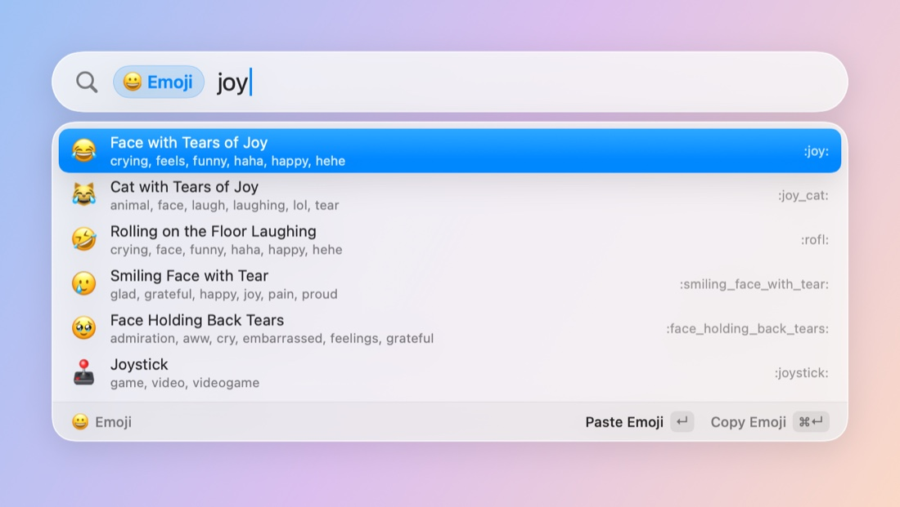

# Writing Fastlight extensions

An extension adds results to Fastlight. It is a folder with an
`extension.json` and a program in any language (shell, Python, Go, Node,
Swift…) that reads requests on stdin and writes replies on stdout, one JSON
object per line.

- **Keyword mode:** type the extension's keyword (`bc `, `go `) and it owns the
  result list. Backspace past the keyword to go back to normal search.
- **Global mode (opt-in):** a few results in the extension's own section,
  next to Applications and Files, when it answers within 80 ms.

Fastlight ships with these, built the same way:

- **Emoji.** Type `:` and a name or keyword (`:joy`, `:thumbs`, `:tada:`), or
  `emoji ` and the same. ↵ pastes into the app you were using, ⌘↵ copies.
  Queries of 3+ letters also show the top 3 emoji in normal search. `:tone`
  picks a skin tone.
- **Calculator.** Type math in normal search (`1920*1080`, `2^10`,
  `(3+4)/2`, `sqrt(2)`, `15% of 80`) and the answer is the Top Hit; or type
  `=` first to always get an answer or the reason there's none. ↵ copies the
  answer (without thousands separators, so it pastes cleanly), ⌘↵ pastes it.
  It knows `+ − × ÷` (also `*`, `/`, `x` between numbers), `^` or `**`,
  parentheses, `%` (`80 + 10%` is 88), `!`, `pi`, `e`, `tau` and `sqrt`,
  `cbrt`, `abs`, `round`, `floor`, `ceil`, `ln`, `log`, `log2`, `exp`,
  `sin`/`cos`/`tan` and their inverses (radians), `deg` and `rad`. Decimals
  take `.`, and `,` too where that's the decimal separator. Division by zero
  has no result.
- **Conversions.** Type a conversion in normal search and the answer is the
  Top Hit, or type `convert ` first for a few conversions at once, world
  clocks and the week number. ↵ copies the answer (numbers without
  thousands separators), ⌘↵ pastes it. All offline.
  - Units: `10 km in mi`, `10km to miles`, `72f in c`, `100 °F`,
    `5 gb in mb`, `1 GiB in MB`, `3 ft 4 in in cm`, `60 mph in km/h`,
    `2 cups in ml`, `1 acre in m2`, `30 mpg in l/100km`,
    `how many ml in 2 cups`. Length, mass, temperature, volume (US cups,
    gallons and fluid ounces; `imp gal` for imperial), area, speed, data
    (`KB` is 1000 bytes, `KiB` 1024), time, energy, power, pressure, angle
    and fuel economy. With no target (`10 km`) it picks the usual one.
  - Time: `time in tokyo`, `tokyo time`, `utc`, `pst time`,
    `3pm london in nyc`, `15:00 in tokyo` (from here), `9am pst` (to here).
    Cities come from the time zone database, plus common names and
    abbreviations (NYC, SF, PST, CET).
  - Dates: `days until dec 25`, `days since 2024-01-01`,
    `how long until friday`, `days between 2026-01-01 and 2026-12-31`,
    `today + 90 days`, `90 days ago`, `in 2 weeks`, `week number` (ISO 8601).

  Normal search only answers what is clearly a conversion: a number and a
  unit with a target (`5 m in ft`), or a unit that can't be anything else
  (`10 km`, but not `3 in`, `5 m` or `3 days`); `time in …` or `… time`
  with a known place; a time of day with a place; the date phrases above.
  `time machine`, `tokyo` or `dec 25` stay plain searches; `convert tokyo`
  or `convert dec 25` answer.
- **System Settings.** Type a pane's name in normal search (`bluetooth`,
  `wi-fi`, `displays`, `battery`, `login items`, `desktop & dock`) or a
  Privacy & Security page (`full disk access`, `screen recording`,
  `camera`), and ↵ opens it. Other names work too (`dark mode`, `dock`,
  `updates`, `fda`). Type `settings ` or `pref ` to list them all, and to
  also search what's inside each pane (`settings pair` finds Bluetooth).
  The panes are read from the installed System Settings, in your language,
  so they match your macOS.
- **Shortcuts.** Your shortcuts from the Shortcuts app: in normal search
  when the name matches word by word (`resize`, `go sleep`), or all of them
  after `sc `, `shortcut ` or `shortcuts `. ↵ runs it, ⌘↵ opens it in
  Shortcuts. In keyword mode, what you type after a whole name is passed
  as input: `sc translate good morning` runs Translate with "good morning".
- **System.** Lock Screen, Sleep, Sleep Displays, Start Screen Saver,
  Toggle Dark Mode and Eject All Disks run on ↵. Empty Trash, Log Out,
  Restart and Shut Down ask first: ↵ turns the result into "Confirm
  Restart?" for 5 seconds, and only ↵ on that does it (⌘↵ cancels). Normal
  search only offers them for their name or a 4+ letter start of it
  (`sleep`, `lock`, `rest`; not `sleep.txt` or `sleeping`); `sys ` lists
  them all. Toggle Dark Mode, Empty Trash, Log Out, Restart and Shut Down
  send Apple events, so macOS asks once to let Fastlight control System
  Events, Finder or loginwindow.
- **Contacts.** Type `contact ` (or `contacts `) and a name, nickname,
  company, email address or phone number (`contact elena`, `contact acme`,
  `contact elena@`, `contact 612 345`). ↵ opens the card in Contacts, ⌘↵
  copies the email address (or number). When one person is in view, their
  addresses and numbers follow as rows of their own: ↵ emails or calls
  (through FaceTime and your iPhone), ⌘↵ copies, plus Message and FaceTime
  rows (⌘↵ on FaceTime is audio only). Names of 3+ letters also show up to 3
  people in normal search.
- **Calendar.** `cal ` (or `calendar `, `event `, `events `, `agenda `) on
  its own is the agenda: what's left of today, all-day events first, then
  the next two weeks. With words (`cal review`), the events whose title,
  place, calendar or notes match, soonest first. ↵ shows the event in
  Calendar, ⌘↵ copies what, when and where. Normal search shows up to 2
  upcoming events whose title matches 3+ letters.
- **Reminders.** `remind ` (or `reminder `, `reminders `) on its own lists
  what isn't done: by due date, so overdue first, then undated ones, newest
  first, with priority as `!!!`/`!!`/`!`. With words, it searches titles,
  notes and lists. ↵ shows the reminder in Reminders, ⌘↵ copies it. Normal
  search shows up to 2 whose title matches.

Contacts, Calendar and Reminders only read, never write, and only from this
Mac's own stores (which include the accounts synced to it, like iCloud):
nothing leaves the Mac. macOS asks before Fastlight can read any of them,
once each, and Fastlight only lets it ask when you pick **Allow Access to
Contacts…** (or Calendars…, Reminders…), which is what the keyword shows
until then. Typing in normal search never asks; those sections just stay
empty without access. If you said no, the keyword shows a shortcut to
System Settings › Privacy & Security, where Fastlight's switch is.
- **Dictionary.** Type `define ` or `dict ` and a word (`define serendipity`)
  for its senses, from the dictionaries macOS ships, offline. ↵ opens the word
  in Dictionary.app, ⌘↵ copies the definition. It uses the dictionaries
  turned on in Dictionary › Settings, in their order, like Look Up: the first
  one that has the word answers, so a bilingual dictionary gives
  translations. Definitions only show after `define ` or `dict `, never in
  normal search, which stays apps and files: most words have an entry, and
  a definition under every query would push your files down.
- **Web.** Type a web address in normal search (`github.com`,
  `example.org/path`, `localhost:3000`, `https://…`) and opening it is the
  Top Hit. Type `web ` and anything to search the web: ↵ searches with the
  default engine, and the rows below it search with the others (DuckDuckGo,
  Bing, Ecosia, Wikipedia in your language, YouTube). ⌘↵ copies the link.
  There's no "search the web" row in normal search, where it would sit
  above your files; `web ` is for that. Fastlight makes no requests: your
  browser opens the page.

Address detection is strict so file names stay file names: a domain needs a
TLD from a short list of common ones (`.com`, `.net`, `.io`, `.dev`, country
codes…). TLDs that are also file extensions (`.app`, `.sh`, `.zip`, `.ai`,
`.so`, `.pl`, `.cc`, `.in`, `.mov`, `.org`, `.info`, `.pt`, `.ly`, `.cl`,
`.br`, `.ar`, `.au`, `.it`, `.tr`, `.me`) also need `www.`, a port or a path
(`brew.sh/`, `wikipedia.org/wiki/x`), and any other one needs the scheme
(`https://my-nas.local`). So `notes.md`, `main.swift`, `Safari.app` and
`todo.org` are never addresses.

The default engine is Google, as in Safari. To change it, or add engines,
pick **Default Search Engine** after typing `web ` (it creates the file and
opens it), or edit
`~/Library/Application Support/Fastlight/ExtensionData/com.elboletaire.fastlight.web/settings.json`:

```json
{
  "engine": "duckduckgo",
  "engines": [
    {"id": "kagi", "name": "Kagi", "url": "https://kagi.com/search?q=%s"}
  ]
}
```

`engine` is the id of the default: `google`, `duckduckgo`, `bing`, `ecosia`,
`wikipedia`, `youtube`, or one of yours. `engines` adds engines (or replaces a
built-in with the same id); `%s` is where the query goes, percent-encoded.
Both keys are optional, changes apply on the next search, and problems show
up as a row in `web ` results while the rest still works.



How it works inside is in [design.md](design.md).

## Quickstart: bc in 30 lines of sh

This wraps the `bc` command (the built-in calculator doesn't need it; it's a
small, real example).

1. Make a folder in `~/Library/Application Support/Fastlight/Extensions/`
   (menu bar icon › Extensions › Open Extensions Folder):

   ```sh
   cp -R examples/extensions/bc ~/Library/Application\ Support/Fastlight/Extensions/
   ```

2. `extension.json` says what it is and how to run it:

   ```json
   {
     "id": "com.example.bc",
     "name": "bc",
     "version": "1.0.0",
     "icon": "terminal",
     "keywords": ["bc"],
     "command": ["/bin/sh", "bc.sh"]
   }
   ```

3. The program prints a handshake, then answers each request line
   ([full script](../../examples/extensions/bc/bc.sh)):

   ```sh
   echo '{"type":"ready","protocol":1}'
   while IFS= read -r line; do
     id=$(printf '%s\n' "$line" | sed -n 's/.*"id":\([0-9]*\).*/\1/p')
     [ -n "$id" ] || continue # notifications have no id
     expr=$(printf '%s\n' "$line" | sed -n 's/.*"query":"\([^"]*\)".*/\1/p')
     result=$(printf '%s\n' "$expr" | bc -l)
     printf '{"id":%s,"items":[{"id":"r","title":"%s","actions":[{"type":"copy","text":"%s"}]}]}\n' \
       "$id" "$result" "$result"
   done
   ```

4. Open Fastlight and type `bc 2*21`. The first time, the panel says the
   extension needs your permission; ↵ (or Review…) asks whether to allow
   it, showing what it will run. Then the result shows up; ↵ copies.

There is also a Python example, [quicklinks](../../examples/extensions/quicklinks)
(`go gh` opens GitHub). It needs `python3`, which macOS only has once the
Xcode Command Line Tools are installed; prefer `/bin/sh`, `/bin/zsh`,
`osascript` or a compiled binary for extensions you share.

Fastlight rescans the folder every time the panel opens, so editing or
dropping in an extension needs no restart. Any change to its files asks for
approval again. Problems show up in the menu (Extensions › ⚠︎ …), and each
extension's stderr goes to `~/Library/Logs/Fastlight/Extensions/<id>.log`
(Extensions › Show Extension Logs).

## Manifest reference

| Key | Required | Rules |
|---|---|---|
| `id` | yes | Lowercase reverse-DNS, like `com.example.bc`. Unique. |
| `name` | yes | Up to 40 characters. Shown on the pill, the section and the menu. |
| `version` | yes | Semantic version, like `1.0.0` or `1.1.0-beta.1`. |
| `keywords` | yes | 1–5 keywords. One ending in a letter or digit needs a space after it (`go gh`); one ending in a symbol doesn't (`:joy`). A keyword a built-in already uses (`:`, `emoji`, `=`, `convert`) stays the built-in's. Can't start with `'` `^` `!` `.` `/` `~` `"`, or with a search filter (`ext:`, `in:`, `type:`…), so `in:~` or `type:image` are refused: those stay file searches. |
| `command` | yes | Executable and arguments. Relative paths are inside the folder (and must be executable: `chmod +x`); absolute ones are for interpreters (`/bin/sh`, `/usr/bin/osascript`). Runs with the folder as working directory. |
| `description` | | Up to 200 characters; shown when asking for approval. |
| `author` | | Up to 100 characters. |
| `homepage`, `source` | | `http(s)` URLs. `source` is where the code lives; future one-click installs and updates will use it. |
| `icon` | | See [Icons](#icons). |
| `global` | | Opt in to normal search: `{"maxResults": 1–5 (3), "minQueryLength": 1–10 (2)}`. |
| `minFastlightVersion` | | The oldest Fastlight that can run it. |

Unknown keys are an error, so typos don't go unnoticed.

## Protocol reference (version 1)

Every line is one JSON object. Write a line per message and flush it (most
languages buffer stdout when it isn't a terminal: `flush=True` in Python,
`setvbuf`/`fflush` in C, `print` is fine in sh).

### Environment

| Variable | |
|---|---|
| `FASTLIGHT_PROTOCOL` | `1` |
| `FASTLIGHT_VERSION` | Fastlight's version. |
| `FASTLIGHT_EXTENSION_ID` | Your id. |
| `FASTLIGHT_DATA_DIR` | A folder for your settings and caches. Don't write into your own folder: that changes it and asks the user for approval again. |
| `FASTLIGHT_LANGUAGE` | The language Fastlight's UI is in (`en`, `ca`, `es`…), in case you want to match it. Optional: Fastlight shows your titles as you send them. |

`PATH` is `/usr/bin:/bin:/usr/sbin:/sbin:/opt/homebrew/bin:/usr/local/bin`.
`HOME`, `USER`, `LOGNAME`, `TMPDIR`, `LANG`, `LC_ALL` and `SHELL` are passed
on from Fastlight when set (`LANG` defaults to `en_US.UTF-8`); nothing else
is.

### Handshake

Your first line, within 5 seconds of starting:

```json
{"type":"ready","protocol":1}
```

### search

```json
{"id":3,"limit":50,"mode":"keyword","query":"joy","type":"search"}
```

`mode` is `keyword` or `global`; `query` is what follows the keyword (maybe
empty: show something useful) or the whole query in global mode. Reply with
up to `limit` items:

```json
{"id":3,"items":[{"id":"1f602","title":"Face with Tears of Joy","subtitle":"laugh, lol",
  "icon":{"emoji":"😂"},"accessory":":joy:",
  "actions":[{"type":"paste","text":"😂","title":"Paste Emoji"},{"type":"copy","text":"😂"}]}]}
```

or `{"id":3,"error":"what went wrong"}`, which the user sees.

Keys are sorted and there's no extra whitespace, which makes `sed` usable in
shell scripts, but use a real JSON parser when you can.

### run

Sent when the user picks a `run` action:

```json
{"data":3,"id":4,"item":"tone-3","name":"setTone","query":"tone","type":"run"}
```

Reply `{"id":4}` when done, or `{"id":4,"error":"…"}`.

### Notifications

No `id`, no reply. Ignore types you don't know.

```json
{"action":"paste","item":"1f602","type":"picked"}
```

`picked` says the user used one of your items (not sent for `run`, which you
see anyway). Use it for recents or ranking.

### Items

| Key | |
|---|---|
| `id` | Required, unique in the reply. |
| `title` | Required. |
| `subtitle` | Smaller, under the title. |
| `accessory` | Right-aligned text. |
| `icon` | See below. Defaults to your extension's icon. |
| `actions` | ↵ runs the first, ⌘↵ the second. |
| `topHit` | `true` asks to be the Top Hit in normal search. Only built-in extensions get it (the calculator's answer); it's ignored for others, so no extension can take ↵ away from apps and files. |

### Actions

| Action | Does |
|---|---|
| `{"type":"open","target":"https://…"}` | Opens a URL or a path (`~` works). |
| `{"type":"copy","text":"…"}` | Copies and closes. |
| `{"type":"paste","text":"…"}` | Pastes into the app the user was in. Needs Accessibility permission for Fastlight; without it, Fastlight copies and tells the user to press ⌘V. |
| `{"type":"reveal","path":"…"}` | Shows a file in Finder. |
| `{"type":"run","name":"…","data":…,"then":"close"}` | Sends you a `run` request. `then`: `close` (default), `refresh` (search again and stay), `stay`. |

Any action can have a `"title"`, shown in the action bar.

### Icons

| Form | Shorthand |
|---|---|
| `{"emoji":"😂"}` | `"😂"` (no ASCII letters) |
| `{"symbol":"globe"}` (an [SF Symbol](https://developer.apple.com/sf-symbols/)) | `"globe"` |
| `{"path":"icon.png"}` (an image, or any file for its Finder icon; relative to your folder) | `"./icon.png"`, `"/abs"`, `"~/x"` |
| `{"app":"com.apple.Safari"}` (an app's icon) | |

### Rules of the road

- Answer every request with its `id`; replies may come in any order.
- Keep going until stdin closes, then exit.
- Fastlight keeps at most one search in flight and skips queries typed
  meanwhile, so a slow extension sees fewer, newer queries.
- In global mode you have 80 ms per keystroke, process start included (it
  starts when the panel opens). Later answers are dropped.
- Keyword searches time out after 3 s, `run` after 10 s. Three timeouts in a
  row restart you, and that counts as a crash: three crashes in a minute
  (restarts for timeouts included) turn you off until Extensions › Reload
  Extensions.
- Up to 20 lines that aren't protocol messages are tolerated (and logged), and
  no line may exceed 1 MiB. Log to stderr instead.
- Idle for 5 minutes, you're stopped: stdin closes, then SIGTERM after
  0.5 s if you're still running, then SIGKILL at 1.5 s. You're started again
  on next use. When Fastlight quits, stdin closes and SIGTERM follows at
  once, with no SIGKILL after it: exit on EOF or SIGTERM.

## Security

Extensions run with Fastlight's permissions, which can include Full Disk
Access. Fastlight runs nothing from the extensions folder until the user
approves it, and asks again whenever any file in the extension's folder
changes (a SHA-256 over all of them, `.git` included, checked again right
before each start). Symlinks that lead out of your folder are refused,
since the code behind them could change unseen; keep everything you run
inside it. Any extension can be turned off in the
Extensions menu. Only install extensions you trust, as you would any
command-line tool.
